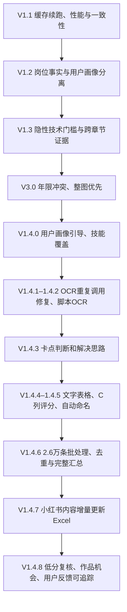

# 🧭 职涯罗盘 · Job Decision Copilot

**把一堆招聘截图、CSV 或 Excel，变成一份有原文依据的投递清单。**


[快速开始](#快速开始) · [输出示例](#输出示例) · [运行记录](#运行记录) · [详细文档](#详细文档)

同样写着「Agent 工程师」，有的岗位要搭建评测体系，有的主要做 Java 后端。职涯罗盘先看岗位描述（JD）里的实际职责和硬性要求，再结合你的经历、方向、红线和抗压偏好给出 **1–5 分推荐**。打开 Excel，就能看到分数从哪来、面试前该核实什么、该优先准备哪些能力。

## v1.4.8 更新（2026-11-25）

- **低分岗位复核。** 筛选完成后，检查 1–3 分岗位里的经验冲突、职责歧义和待确认条件。有待复核项时，Excel 增加「低分复核」工作表，并给出 JD 证据与聊天提醒。已有运行也可通过 `audit` 命令复查。
- **作品机会建议。** 按需运行 `showcase`，结合高分岗位的共同技能需求和个人画像，生成最多 5 个作品选题，附上岗位证据、个人证据与下一步准备建议。
- **用户反馈与数据流转说明。** 新增三类用户反馈的处理路径，以及从反馈到功能设计的记录，便于理解复核、作品建议和职场内容更新的使用场景。

使用方式见 [v1.4.8 功能指南](references/feedback-and-opportunities-v148.md)，设计背景见 [用户反馈记录](docs/USER_FEEDBACK.md)。真实误杀召回率和作品展示效果仍待用户验证。

<details>
<summary>版本演进（V1.1 → V1.4.8）</summary>



</details>

图片在平台原生 OCR 路径下由平台模型处理。选择本地 RapidOCR 时，图像识别在当前执行环境进行。招聘原文、评分与画像保存在当前运行目录，数据留存取决于所选平台和部署配置。

## 快速开始

### 在码道导入 Skill

从 GitHub 获取源码，并生成可导入的 Skill 安装包。

```bash
git clone https://github.com/renduermai/Job-Decision-Copilot.git job-decision-copilot
git -C job-decision-copilot archive --format=zip --prefix=job-decision-copilot/ --output=../job-decision-copilot-v1.4.8-install.zip HEAD
```

在码道的 Skill 导入入口上传生成的 ZIP。然后附上招聘截图、CSV 或 Excel，在对话里试一句：

> 用职涯罗盘筛选我上传的岗位。我想找 AI 应用或 Agent 评测岗，偏传统后端的岗位请标出来。先帮我确认画像和红线，再输出 Excel，并告诉我最值得优先准备的三项能力。

首次使用可以从 **A / B / C 示例画像**开始，也可以直接提供自己的经历、目标和红线。筛完后下载 `AI岗位筛选_[关键词].xlsx`，在对话中查看 Top 10 岗位和优先准备建议。

### 本地检查或接入其他 Agent

在仓库根目录运行以下命令。内置脚本要求 Python 3.10+，建议在独立虚拟环境安装依赖。

```bash
python -m pip install -r requirements.txt
python scripts/run.py --version
python scripts/run.py welcome
python -m unittest discover -s evals -q
```

支持从目录加载 Agent Skills 的客户端可使用整个 `job-decision-copilot/` 目录，入口为 [SKILL.md](SKILL.md)。完整流程需要 Agent 提供 JD 提取及语义评估，Python 负责校验、应用评分规则和导出。纯文本直接进入流程。截图可使用码道原生视觉工具，或按文档配置可选的本地 RapidOCR。其他客户端的工具适配需在实际环境验证。 [运行与接口](references/runtime.md) · [本地 OCR](references/local-ocr-workflow.md)

## 输出示例

下面是一条虚构岗位，用来说明如何从 Excel 里的证据走到下一步准备。

| 岗位 | 推荐等级 | JD 证据 | 卡点判断与准备方向 |
| --- | --- | --- | --- |
| Agent 评测工程师 | **4 / 5** | “搭建评测集，跟踪线上回答质量与回归问题” | 团队可能需要统一质量指标。准备一个评测集或质量回归案例，并核实目前最关注的指标。 |

Excel 保留原文、JD 全文、岗位类型、评分依据和待确认条件。推荐等级位于 C 列，前三列冻结，便于筛选时对照原始材料。

| 分数 | 如何使用 |
| --- | --- |
| **5** | 近乎完全契合，优先投递 |
| **4** | 高度契合，值得重点准备 |
| **3** | 有潜力，先核实关键条件 |
| **2** | 匹配度较低，降低优先级 |
| **1** | 命中你明确设定的排除条件 |

## 从刷岗到面试准备

- **换方向，直接重评。** 截图识别、岗位事实和个人评估分开保存。同一批岗位换目标或红线时，可复用已保存的 OCR 和 JD。
- **批量筛选，先在样本上对齐标准。** 大批量文本支持抽样校准、去重、断点续跑、导入预检、分表和跨文件汇总。
- **从高分岗位找共同要求。** 汇总 Top 10 和优先补齐的能力，把准备时间放在多份目标 JD 都需要的技能上。
- **已有 Excel 可以继续更新。** v1.4.7 支持把职场文章、面试笔记或小红书点点逐字稿带回同一轮筛选，结合当前岗位补充针对性的反向提问等建议。已有对应列可更新，新增列需先确认，原推荐分保留。 [增量更新指南](references/learning-from-content.md)

## 运行记录

| 作者记录的历史场景 | 规模 | 当时耗时 |
| --- | ---: | ---: |
| 招聘截图识别与筛选 | 约 40 张 | 10–18 分钟 |
| 纯文本岗位筛选 | 900 条 | 约 25 分钟 |
| 多文件筛选及汇总 | 19 份文件、26,777 行，去重后 22,700 条 | 2 小时 04 分钟 |

早期 36 张样本集的阶段性加权评测记录包括 **84.6、89.3 和最高 93 分**。这些数字对应当时的数据、平台和模型。V1.4.7 的本地回归覆盖规则与工作簿更新，码道上多轮职场内容更新的语义效果还有待实测。 [评测记录](TESTING.md) · [证据与适用范围](references/evidence-and-limits.md)

## 详细文档

| 想了解 | 阅读 |
| --- | --- |
| Agent 怎么执行完整工作流 | [Skill 入口](SKILL.md) · [原生工作流](references/native-workflow.md) |
| 如何准备个人画像 | [首次使用指南](references/onboarding.md) · [画像模板](assets/profile.example.json) |
| CSV / Excel 如何读入，批量任务如何组织 | [文档输入](references/document-workflow.md) · [批量工作流](references/bulk-workflow-v146.md) |
| 评分如何处理职责、红线和证据 | [岗位事实与画像规则](references/role-facts-and-profile-policy.md) · [评分细则](references/scoring-rules.md) |
| 版本更新了什么 | [更新日志](CHANGELOG.md) |

岗位卡点是依据 JD 做出的推断，可以带到面试中核实。请把个人简历、真实画像、招聘截图和 API 密钥留在自己的工作区。

## 交流反馈

欢迎交流反馈，分享使用体验、问题和改进建议。邮箱 [1124742205@qq.com](mailto:1124742205@qq.com)。